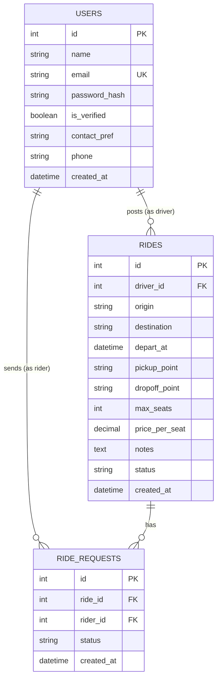

# Database Design (ERD)

> **Status:** Implemented in `backend/app/models.py` (first migration, Nov 2026)

## Status Values

| Table | Field | Values | Default |
|---|---|---|---|
| `users` | `contact_pref` | `email`, `phone` | `email` |
| `rides` | `status` | `open`, `full`, `cancelled`, `completed` | `open` |
| `ride_requests` | `status` | `pending`, `accepted`, `declined`, `cancelled` | `pending` |

## Constraints

Enforced by the database:

- `users.email` is unique
- `(ride_requests.ride_id, ride_requests.rider_id)` is unique: a rider can request the same ride only once
- `rides.max_seats` ≥ 1
- `rides.price_per_seat` ≥ 0
- Status and `contact_pref` columns only accept the values above

Enforced in application code (not possible as a simple DB constraint):

- A driver cannot request a seat on their own ride
- Accepted requests for a ride ≤ `rides.max_seats` (check + update in one transaction)
- Rides with `depart_at` in the past are hidden from search

## Notes

- Table is `users`, not `user`: `user` is a reserved word in PostgreSQL.
- Model is `RideRequest`, not `Request`, to avoid confusion with Flask's `request`.
- Pricing is per seat only for the MVP (split pricing is a later feature).
- Times are stored with time zone (`timestamptz`).

## Changing the schema

1. Edit `backend/app/models.py`
2. `flask --app wsgi db migrate -m "describe the change"`
3. Check the new file in `migrations/versions/`
4. `flask --app wsgi db upgrade`
5. Commit the model change **and** the migration file in the same PR, and update this doc
