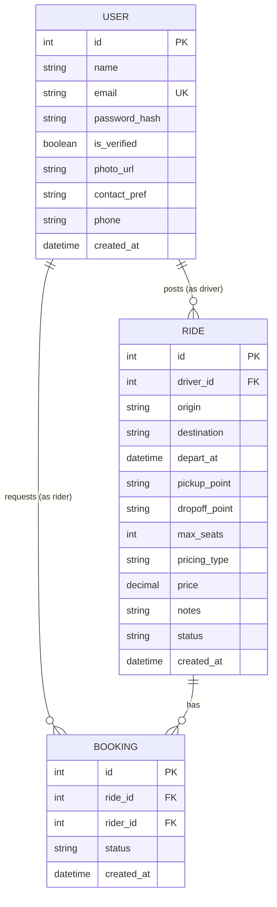

# Database Design (ERD)

> **Status:** Draft — names and fields may change

## Status Values

| Table | Field | Values |
|---|---|---|
| RIDE | `status` | `open`, `full`, `cancelled`, `completed` |
| RIDE | `pricing_type` | `per_seat`, `split` |
| BOOKING | `status` | `pending`, `accepted`, `declined`, `cancelled` |
| USER | `contact_pref` | `email`, `phone`, `in_app` |

## Constraints

- `USER.email` is unique.
- `(BOOKING.ride_id, BOOKING.rider_id)` is unique — no duplicate requests.
- `RIDE.max_seats` ≥ 1.
- Accepted bookings for a ride ≤ `max_seats`.
- `BOOKING.rider_id` ≠ `RIDE.driver_id`.

## Seed Data

_TBD: script to create sample users and rides for local testing and the demo._
