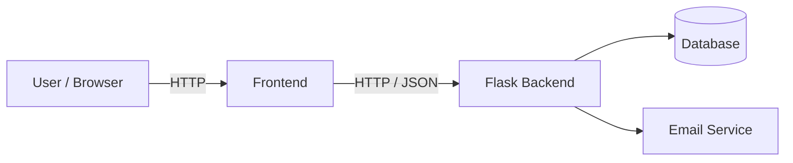

# Technical Design

> **Status:** Draft — stack not finalized

## Tech Stack

| Layer | Technology | Status |
|---|---|---|
| Backend | Python + Flask | Proposed |
| Frontend | HTML/CSS/JavaScript (+ framework TBD) | See [decision 0001](decisions/0001-frontend-approach.md) |
| Database | SQLite (local) → PostgreSQL (deployed) | Proposed |
| ORM | SQLAlchemy | Proposed |
| Auth | Password hashing via a proven library; signed, expiring tokens for email verification | Proposed |
| Email service | TBD (check free-tier limits + spam risk) | Open |
| Hosting | TBD (free tier) | Open |
| Version control | Git + GitHub, GitHub Projects for tasks | Decided |

## Architecture

### Responsibilities

**Frontend** — render pages, handle user input, call the API, show responses and errors.

**Backend** — handle requests, business logic, input validation, auth and permissions, DB access, consistent error responses, sending emails.

**Database** — store users, rides, bookings; enforce relationships and integrity (foreign keys, unique constraints).

## Key Business Rules

- Only school emails (`@uwo.ca` — confirm) can register.
- Account is inactive until the email is verified; link expires after 24h.
- A driver cannot book their own ride.
- A user can request a seat on the same ride only once.
- Accepting a request must not exceed `max_seats` (check + update in one transaction).
- A ride is hidden from search when full, cancelled, or in the past.
- Contact info is visible only after a booking is accepted.

## Open Questions

- [ ] Frontend framework or not? ([0001](decisions/0001-frontend-approach.md))
- [ ] Hosting platform + cost
- [ ] Email service
- [ ] Split pricing: when is the per-rider price final?
- [ ] Contact card vs in-app chat
- [ ] What happens when an accepted rider cancels?

## Privacy

- Collected: name, school email, password hash, optional photo, optional phone.
- Phone / contact info is shown only to matched riders/drivers.
- Passwords are never stored in plain text.
